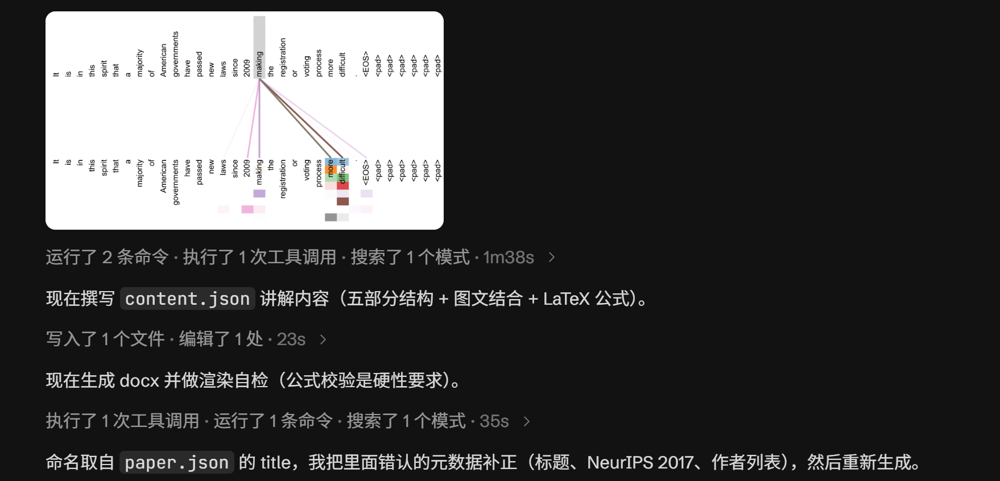
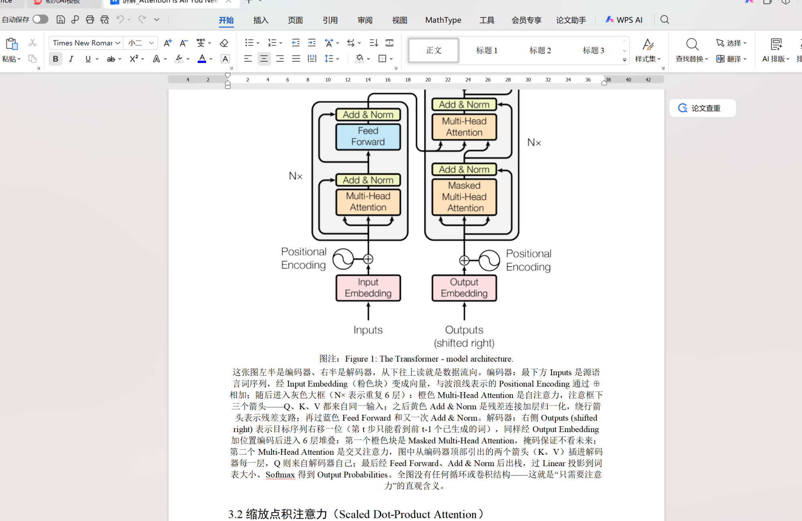

# auto_paper_reading

一个给 AI Agent 用的**论文阅读工具包（skill）**：把本仓库交给带视觉能力的 Agent
（Claude Code / Codex / Qwen Code / Kimi Code 等），对它说一句「阅读 XXX 论文」，
Agent 就会按 `SKILL.md` 工作流自动**搜索下载论文 → 解析裁剪关键图 → 视觉选图 →
图文结合撰写讲解 → 生成 docx → 渲染自检**，最终交付一份图文结合的中文讲解 docx。

**不调用任何 LLM API、不需要任何 API key**：所有「智能」都由 Agent 自己完成，
本仓库只提供机械的解析、裁剪、排版与自检脚本。

## 怎么用

1. 把本仓库放进 Agent 的工作区（克隆后在 Agent 中打开本目录即可；
   Claude Code 也可以把 `SKILL.md` 挂到自己的 skills 路径下）。
2. 对 Agent 说：「阅读 CVPR2025 的 OpenSDI」或「讲解 papers/xxx.pdf」。
3. Agent 按 `SKILL.md` 逐步执行，产出 `output/<论文名>/<论文名>/讲解_*.docx`。

> 前提：Agent 具备联网检索与读图能力；本机装有 Python 3.10+ 与 Node.js。

## 效果演示

以对「Attention Is All You Need」的一次完整阅读为例：

| ① 一句话触发 | ② Agent 自动制作（看图 → 撰写 → 自检） | ③ WPS 打开成果 |
|:---:|:---:|:---:|
|  |  |  |

用户只需说「我想要阅读下 Attention is all you need」，Agent 便自动完成搜索下载、
解析裁剪、撰写图文讲解、渲染自检，最终交付可直接用 WPS 打开的讲解文档。

## 讲解内容结构（五部分，三级编号标题 1 / 1.1 / 1.1.1）

1. **基础知识讲解** —— 前置知识拆成小点逐个讲（CLIP、ViT、注意力、Adapter/LoRA、
   Prompt Learning、测试时自适应、高频信号与 DCT、任务设定等），每点注明本文用法
2. **方法灵感和发表期刊** —— 发表信息、动机、灵感来源
3. **方法** —— 分模块讲解，配关键流程图/架构图，三级小标题细分
4. **输入内容的变换过程** —— 数据流视角：每一步如何变换、每步学什么、注意力如何变化
5. **创新点、可以借鉴的经验** —— 核心创新点 + 实验结果（**直接调用论文原表**逐表讲解）+ 可借鉴经验

## 生成 docx 的格式规范

| 元素 | 字体 | 字号 |
|---|---|---|
| 封面标题 | 黑体（西文 Times New Roman 正体） | 18pt |
| 一级标题 | 黑体 | 三号 16pt |
| 二级标题 | 黑体 | 四号 14pt |
| 三级标题 | 黑体 | 小四 12pt |
| 正文 | 宋体 | 小四 12pt |
| 图注/说明 | 宋体 | 10.5pt |
| 表格中的文字 | 宋体 | 小五 9pt |
| 参考文献 | 宋体 | 六号 7.5pt（整节匹配"参考文献/References"生效） |

- **英语字母和数字一律 Times New Roman 正体**（中文正体，排版脚本自动切分）
- **仅公式中的变量（英语字母）采用斜体**（由 OMML 数学样式承担），其他情况不做改变
- **全文档字体颜色统一黑色**（含标题/正文/公式/图注，禁止主题蓝）
- 标题**自动编号**（一级 1、二级 1.1、三级 1.1.1），content.json 只写标题文字
- 正文专业名词用 `**术语**` 加粗；公式用 `$LaTeX$` 包裹，自动转为 OMML 由 **WPS 原生渲染**
- 实验结果直接裁剪论文原表（Table）高清嵌入 + 逐表讲解

## Agent 执行流程（详见 SKILL.md）

```
输入（论文题目或本地文件）
  ↓ ⓪ 搜索下载：联网找开放获取 PDF，落到 papers/ 并验证文字层
  ↓ ① 解析裁剪：python run.py papers/xxx.pdf --stage prep --out output/xxx
  ↓ ② 视觉分析：Agent 逐张看候选图选关键图，不理想则按坐标重裁
  ↓ ③ 撰写讲解：写 output/xxx/content.json（五部分 + 图文结合 + LaTeX 公式）
  ↓ ④ 生成 docx：python run.py papers/xxx.pdf --stage docx --out output/xxx
  ↓ ⑤ 自检：--verify 渲染预览逐页核验 + python tools/verify_math.py
  ↓ ⑥ 交付：对话中讲解 + 告知 docx 路径
```

### 交付自检（硬性要求）

```bash
python run.py papers/xxx.pdf --stage docx --out output/xxx --verify   # WPS 无头渲染预览
python tools/verify_math.py "output/xxx/讲解_标题.docx"                # 指定交付版本，检查对应 PDF
```

再对公式密集区域视觉抽验；全部通过才交付。输出 docx 被占用（如正被 WPS 打开）时自动写 `_v2` 文件。

## 目录结构

### 报告排版（v0.2.22）

- 正文与图后讲解默认两端对齐；封面、图注保留居中。
- 正文与图后讲解首行缩进 2 个汉字，随字号调整；标题、独立公式和图注不缩进。
- 独立公式单独一行，居中显示、编号右对齐，全文连续编号（1）、（2）……。
- 推荐公式块：`{"type":"equation","latex":"y = Wx + b"}`，不手工写编号。
- `$...$` 在句内渲染为可编辑公式，不编号；多行 `$$...$$` 自动拆为独立编号公式并保留前后文字。句内变量和上下标同样使用 LaTeX。
- 使用 Python `--stage docx` 完成 OMML 公式注入；Node 脚本仅为中间排版阶段。
- 数学检查强制执行：逐公式核对 `_`/`^` 与 OMML 上下标结构，扫描正文及数学对象残留；失败阻止成功返回，同名 `.math_audit.json` 记录位置及问题。
- 文件名等字面下划线须用 `math_review_exceptions` 记录完整段落和 `reason` 后逐项复核；公式内部残留不能豁免。交付前仍须渲染并逐页核对，自动检查不能证明数学语义或视觉效果正确。
- 更新对今后生成或重新生成的报告生效，已有 DOCX 需重新生成。
- 图片默认等比例缩到最高 4.5in，避免大图挤走正文；图片与图注保持相邻，标题与后文同页。
- 可在顶层 `layout` 设置 `max_figure_height_in` / `max_figure_width_in`，单个 figure 或引用它的 block 可用 `max_height_in` / `max_width_in` 覆盖。
- 章节或 block 支持 `page_break_before: true`；`{"type":"page_break"}` 可在下一段内容前换页。
- `--verify` 生成 `verify/layout_audit.json`，根据实际文字和图片位置提示大块留白。Agent 按 SKILL.md 主动检查全篇、调整单图尺寸或分页并重新渲染；审计不会自行改写内容，也不保证一次排版就最优。

```
├── SKILL.md / README.md        # 项目说明与 Agent 工作流
├── docs/images/                # README 效果演示截图
├── run.py                      # CLI 入口（prep / docx 两阶段）
├── src/auto_paper_reading/     # 核心 Python 包（无 LLM API 依赖）
│   ├── parser/                 #   解析层（pdf/docx/doc 统一为 PaperDocument）
│   ├── figures.py              #   配图提取与裁剪（光栅图 + 图注定位矢量图）
│   ├── omml.py                 #   LaTeX → OMML 公式转换（WPS 原生渲染）
│   ├── models.py / docx_content.py  #   数据模型 / content.json 中间格式
│   └── cli.py                  #   命令行编排
├── tools/
│   ├── build_docx.js           # docx-js 排版（字体/字号/编号/公式占位）
│   └── verify_math.py          # 公式渲染交付自检
├── papers/                     # 论文输入目录（Agent 自动下载或用户提供）
├── output/                     # 讲解输出目录（每篇论文一个子目录）
├── tests/                      # 22 个单元测试（python -m pytest tests/ -q）
├── requirements.txt / package.json / pytest.ini
```

## 依赖

- Python 3.10+：`pymupdf`、`python-docx`、`pillow`、`lxml`
- Node.js：`docx`（docx-js 排版，`npm install`）
- WPS Office：仅 `.doc/.docx → PDF` 输入转换与 `--verify` 预览渲染
  （无头 `kwpsconvert word2pdf`，需显式 `--allow-wps` / `--verify` 才调用）
- **不需要**：任何 LLM API key、OpenAI SDK、联网模型服务
